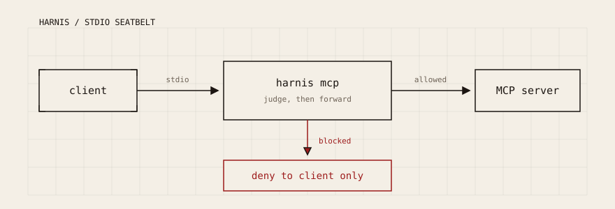

# Harnis

**A seatbelt for MCP — not a sandbox.**

Harnis sits on stdio between the client and a server. It judges `tools/call` and path-like `resources/read` **before** the child sees them. A denial returns to the client; it never becomes a tool execution.

Pair it with [Witnis](https://github.com/L00PLeGeNd/Witnis) in the **Trusted Agent Loop**: Witnis grounds the claim (impact · evidence · PR gate · gated verify); Harnis constrains which tools may run. Full threat model: [THREAT_MODEL.md](THREAT_MODEL.md).

```bash
# Preferred: Witnis writes wrap + policy + index
witnis loop-init

# Or wrap any stdio MCP by hand
npx -y harnis mcp --preset coding-agent --policy .harnis/policy.json -- witnis mcp
npx -y harnis mcp --preset github -- github-mcp-server stdio
```

```text
BLOCKED: agent attempted to delete a file on GitHub — … (policy: github-delete)
```

Already have an MCP config?

```bash
npx -y harnis init
npx -y harnis status
```

**Python 3.11+.** The npm package only spawns `python -m harnis`. This is not a Node security runtime.

Out of scope until traffic passes through `harnis mcp`: URL MCP, unresolvable symlinks, renamed tools with no credential args, and anything that never hits the proxy. Read the [threat model](THREAT_MODEL.md) before treating this as a jail.

---

## What it does

| Piece | Role |
| --- | --- |
| `harnis mcp` | Stdio JSON-RPC proxy; blocks matched `tools/call` / `resources/read` |
| `harnis init` / `status` | Project policy + wrap local MCP configs |
| `harnis scan [--apply]` | Find bare catalog servers; optional in-place wrap |
| `harnis hook` | Optional editor hook adapter (same policy) |
| `harnis protect` / `probe` | Best-effort Python / transcript checks — see threat model |



Primary presets:

| Preset | Denies (examples) |
| --- | --- |
| `coding-agent` (default) | Credential paths (any tool args), opaque/encoded shell, `rm -rf`, secret-shaped text |
| `github` | `delete_file` / `delete_repository`; writes to default branch |
| `readonly` | Writes, shell, outbound sends |
| `ci` | Every shell call |

Extra presets (`postgres`, `slack`, `browser`, `email`) remain in code for experiments; they are not the product.

Session budgets (optional, via `.harnis/policy.json`): `empty_edit_limit`, `max_tool_calls`, `max_unique_paths`.

`scan` understands Claude Code / Desktop first, then Codex (`config.toml`), then common editor MCP files. Remote `url` servers are reported and **not** wrapped.

---

## Policy file

```json
{
  "deny_path_parts": ["vault"],
  "deny_file_names": ["token.txt"],
  "allow_path_parts": ["fixtures"],
  "deny_tools": ["remove_repo_file"],
  "empty_edit_limit": 5,
  "max_tool_calls": 200,
  "max_unique_paths": 80
}
```

`deny_tools` is how a project closes renamed-tool gaps that presets miss. Credential paths and secret-shaped strings are scanned in **every** `tools/call` argument tree regardless of tool name.

```bash
harnis mcp --policy .harnis/policy.json --preset coding-agent -- <server>
```

---

## Develop

```bash
python -m pip install -e . pytest
python -m pytest -q
python -m pytest tests/test_adversarial.py -q
```

MIT.
